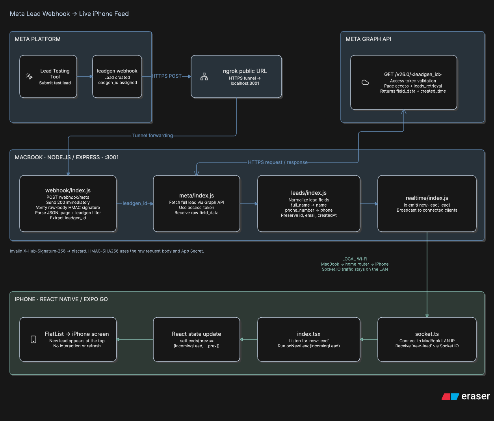

# MetaLeadPulse

A Proof of Concept that demonstrates real-time Meta Lead Ads integration with a React Native application.

When a lead is submitted through Meta's Lead Testing Tool, it appears live inside an already-open React Native app — no manual refresh, no device interaction.

---

## What it proves

```
Meta Lead Testing Tool
        ↓
Meta fires a leadgen webhook event
        ↓
Node.js backend receives and verifies it
        ↓
Backend retrieves lead from Meta Graph API
        ↓
Backend normalizes and emits via Socket.IO
        ↓
React Native app receives "new-lead" event
        ↓
Lead card appears on screen automatically
```

---

## Architecture



---

## Repository structure

```
MetaLeadPulse/
│
├── backend/
│   ├── src/
│   │   ├── server.js          ← entry point: Express + Socket.IO + routes
│   │   ├── webhook/
│   │   │   └── index.js       ← GET verification + POST event handler
│   │   ├── meta/
│   │   │   └── index.js       ← Graph API client (retrieveLead)
│   │   ├── leads/
│   │   │   └── index.js       ← normalizer (normalizeLead)
│   │   └── realtime/
│   │       └── index.js       ← Socket.IO publisher (publishLead)
│   ├── .env.example           ← required environment variables (template)
│   └── package.json
│
├── mobile/
│   └── src/
│       ├── app/
│       │   └── index.tsx      ← Leads screen (main UI)
│       └── services/
│           └── socket.ts      ← Socket.IO client (shared connection)
│
└── docs/
    ├── 01-problem-understanding.md
    ├── 02-meta-integration-research.md
    ├── 03-architecture.md
    ├── 04-build-sequence.md   ← full step-by-step build log
    └── decisions/
        ├── 001-realtime-communication.md
        └── 002-no-persistent-storage.md
```

---

## Tech stack

| Layer | Technology |
|---|---|
| Mobile | Expo + React Native (TypeScript) |
| Backend | Node.js + Express |
| Realtime | Socket.IO |
| Meta integration | Webhooks + Graph API v26.0 |
| Tunnel (dev) | ngrok |
| Secrets | dotenv |

---

## Backend — file by file

### `backend/src/server.js`
Entry point. Creates the HTTP server, attaches Socket.IO, mounts all routes, and starts listening on port 3001.

Key decisions:
- Express and Socket.IO share one HTTP server (same port).
- `express.json()` is skipped for `/webhook/meta` — the webhook handler needs raw bytes for HMAC signature verification.
- `realtime.init(io)` is called immediately after `io` is created (dependency injection — avoids circular imports).

→ [`backend/src/server.js`](backend/src/server.js)

---

### `backend/src/webhook/index.js`
Handles everything Meta sends to the backend.

**GET `/webhook/meta`** — one-time verification handshake:
- Meta sends `hub.mode`, `hub.verify_token`, `hub.challenge`
- Backend checks the token against `META_VERIFY_TOKEN` in `.env`
- If matched → echoes `hub.challenge` back → Meta activates the webhook
- This happens **once** during setup. Never again for normal lead events.

**POST `/webhook/meta`** — real lead event delivery:
1. Responds `200 OK` immediately (Meta requires a fast response)
2. Verifies `X-Hub-Signature-256` header (HMAC-SHA256 of raw body + App Secret)
3. Parses raw Buffer → JSON payload
4. Loops through `entry[].changes[]`, filters for `field === 'leadgen'`
5. Extracts `leadgen_id` → calls `retrieveLead()` → `normalizeLead()` → `publishLead()`

→ [`backend/src/webhook/index.js`](backend/src/webhook/index.js)

---

### `backend/src/meta/index.js`
Graph API client. One exported function: `retrieveLead(leadgenId)`.

- Reads `META_PAGE_ACCESS_TOKEN` from `process.env`
- Calls `GET https://graph.facebook.com/v26.0/<leadgenId>?access_token=<token>`
- Returns raw `{ id, created_time, field_data }` response
- Throws a descriptive error if Meta returns an error object

The webhook payload only contains identifiers — **not** the lead's name, email, or phone. This module fetches the actual data.

→ [`backend/src/meta/index.js`](backend/src/meta/index.js)

---

### `backend/src/leads/index.js`
Normalizer. One exported function: `normalizeLead(metaLead)`.

Meta returns data as an array of `{ name, values }` objects — a format specific to Meta's API:
```json
"field_data": [
  { "name": "full_name",     "values": ["Rahul Sharma"] },
  { "name": "email",         "values": ["rahul@example.com"] },
  { "name": "phone_number",  "values": ["+91 9876543210"] }
]
```

This module translates that into the clean application Lead model:
```js
{ id, name, email, phone, createdAt }
```

The React Native app only ever sees this clean shape — it never knows about Meta's `field_data` format.

→ [`backend/src/leads/index.js`](backend/src/leads/index.js)

---

### `backend/src/realtime/index.js`
Realtime publisher. Two exported functions: `init(io)` and `publishLead(lead)`.

- `init(io)` — called once from `server.js` after Socket.IO is created. Stores the `io` reference.
- `publishLead(lead)` — calls `io.emit('new-lead', lead)`, broadcasting to all connected clients.

Why a separate module: `webhook/index.js` and `server.js` don't need to know about each other. This module is the bridge. It uses dependency injection to avoid circular imports.

→ [`backend/src/realtime/index.js`](backend/src/realtime/index.js)

---

## Mobile — file by file

### `mobile/src/services/socket.ts`
Creates one shared Socket.IO connection for the entire app's lifetime.

```ts
const BACKEND_URL = 'http://192.168.1.2:3001';
export const socket = io(BACKEND_URL, { transports: ['websocket'] });
```

Why a separate file: if created inside a component, a new connection would open every re-render. One file → one connection → shared everywhere.

**Note on URL:** `localhost` on a phone/simulator means "this device" — not the Mac. Use the Mac's LAN IP (`ipconfig getifaddr en0`) instead.

→ [`mobile/src/services/socket.ts`](mobile/src/services/socket.ts)

---

### `mobile/src/app/index.tsx`
The Leads screen. The only file the evaluator sees during the demo.

What it does:
1. Imports `socket` from the service file (connection opens on import)
2. `useState<Lead[]>([])` — the leads list starts empty
3. `useState<boolean>(false)` — tracks connection status for the status dot
4. `useEffect(() => { ... }, [])` — registers three listeners on mount:
   - `socket.on('connect')` → sets dot to green
   - `socket.on('disconnect')` → sets dot to red
   - `socket.on('new-lead', onNewLead)` → prepends incoming lead to list
5. `onNewLead`: `setLeads(prev => [incomingLead, ...prev])` — newest lead at top
6. Renders a `FlatList` of lead cards — name, email, phone, timestamp

When `setLeads` is called, React detects the state change and redraws the list automatically. No manual action required.

→ [`mobile/src/app/index.tsx`](mobile/src/app/index.tsx)

---

## Environment variables

Copy `backend/.env.example` to `backend/.env` and fill in the values.

```
META_APP_ID=               # LeadPulse2 app ID from Meta Developer Dashboard
META_APP_SECRET=           # Used to verify X-Hub-Signature-256 on webhook POSTs
META_VERIFY_TOKEN=         # Secret string you choose; entered in Meta Dashboard too
META_PAGE_ID=              # Facebook Page ID associated with the Lead Form
META_PAGE_ACCESS_TOKEN=    # Page token with leads_retrieval + pages_manage_metadata
```

→ [`backend/.env.example`](backend/.env.example)

Credentials stay in the backend only. The React Native app never holds Meta credentials.

---

## Running locally

Three terminals required simultaneously.

**Terminal 1 — Backend**
```bash
cd backend
npm install       # first time only
npm start
```
Expected:
```
Realtime publisher initialized
Backend running on http://localhost:3001
```

**Terminal 2 — ngrok tunnel** (required for Meta webhook delivery)
```bash
ngrok http 3001
```
Copy the `https://xxxx.ngrok-free.app` URL.

After every ngrok restart the URL changes — update the callback URL in the Meta Developer Dashboard and re-subscribe the Page:
```bash
curl -X POST "https://graph.facebook.com/<PAGE_ID>/subscribed_apps?subscribed_fields=leadgen&access_token=<PAGE_TOKEN>"
```

**Terminal 3 — Mobile app**
```bash
cd mobile
npm install       # first time only
npx expo start
```
Press `i` for iOS simulator. Scan QR code with Expo Go for a physical iPhone.

If the status dot shows red, the simulator cannot reach the backend — update `BACKEND_URL` in `mobile/src/services/socket.ts` with the Mac's LAN IP.

---

## Testing the pipeline

**Quick test (no Meta required):**
```bash
curl -X POST http://localhost:3001/test/lead \
  -H "Content-Type: application/json" \
  -d '{"name":"Rahul Sharma","email":"rahul@example.com","phone":"9876543210"}'
```
Lead should appear on screen immediately.

**Real Meta test:**
1. Go to `https://developers.facebook.com/tools/lead-ads-testing`
2. Select your Page and Lead Form
3. Click "Delete Lead" (if one exists), then "Create Lead"
4. Backend logs should show:
```
Webhook POST received — object type: page
Lead event received:
  leadgen_id:    <real id>
Retrieving lead <id> from Meta Graph API...
Lead <id> retrieved successfully
Normalized lead ready:
  id, name, email, phone, createdAt
Emitting new-lead to N connected client(s)
```
5. Lead card appears on the React Native screen without touching the device.

---

## Key security decisions

| What | How |
|---|---|
| Webhook authenticity | `X-Hub-Signature-256` HMAC-SHA256 verified on every POST |
| Webhook ownership | `hub.verify_token` matched against `META_VERIFY_TOKEN` in `.env` |
| API authorization | Page Access Token sent to Graph API over HTTPS |
| Credential isolation | All Meta credentials in `backend/.env` only — never in mobile app |
| Raw body preserved | `express.json()` skips `/webhook/meta` so signature can be verified |

---

## Key architectural decisions

| Decision | Reasoning |
|---|---|
| Socket.IO for realtime | Natural Node.js fit, reconnection built-in, clean event API |
| No persistent storage | PoC only needs to prove live delivery, not historical retrieval |
| Separate modules (webhook, meta, leads, realtime) | Each has one responsibility; changes to one don't affect others |
| `express.raw()` in webhook router only | Global `express.json()` would destroy the raw bytes needed for HMAC |
| Dependency injection for `io` | Avoids circular import: `server → realtime → server` |

Full reasoning in [`docs/decisions/`](docs/decisions/)

---

## Documentation

| File | Purpose |
|---|---|
| [`docs/01-problem-understanding.md`](docs/01-problem-understanding.md) | Requirements, scope, acceptance criteria |
| [`docs/02-meta-integration-research.md`](docs/02-meta-integration-research.md) | Meta webhook, Graph API, permissions research |
| [`docs/03-architecture.md`](docs/03-architecture.md) | System design, component responsibilities, sequence diagrams |
| [`docs/04-build-sequence.md`](docs/04-build-sequence.md) | Complete step-by-step build log with every command and decision |
| [`docs/system-concepts-revision.md`](docs/system-concepts-revision.md) | Concept explanations, analogies, complete end-to-end flow |

---

## Assumptions

- Meta Lead Testing Tool is used for testing. No real ad spend required.
- The React Native app is already open when the test lead is submitted.
- The PoC runs locally with ngrok as the public HTTPS tunnel.
- A single connected client is sufficient for the demonstration.
- No persistent storage — leads appear live but are not stored across sessions.
- `META_PAGE_ACCESS_TOKEN` is a manually obtained long-lived token (~60 days).
